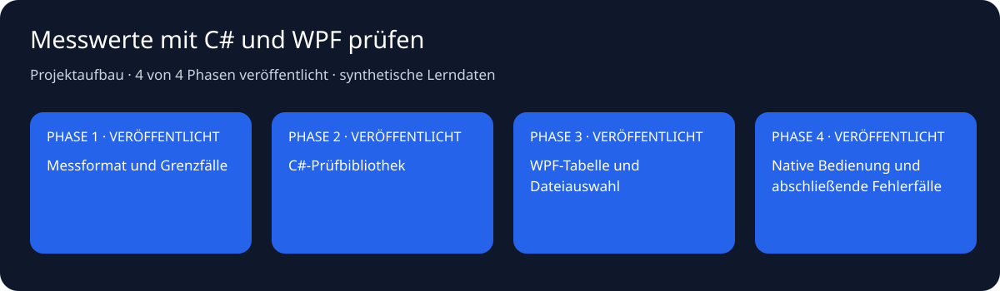

# Messwerte mit C# und WPF prüfen

Messwerte aus einer CSV-Datei sollen gegen einen Toleranzvertrag geprüft und mit verständlichen Fehlerhinweisen in einer Windows-Oberfläche angezeigt werden.



**Veröffentlichungsstand: Phase 4/4.** Dieses eigenständige Repository veröffentlicht zuvor lokal entwickelte, geprüfte und unveränderlich gesicherte Stände. Alle vier dokumentierten Basisphasen sind veröffentlicht. Die technische Entwicklung und die öffentliche Veröffentlichung haben unterschiedliche echte Zeitpunkte.

## Was hier zu sehen ist

| Schritt | Inhalt | Hier veröffentlicht |
|---|---|---|
| 1 | Messformat und Grenzfälle | Ja |
| 2 | C#-Prüfbibliothek | Ja |
| 3 | WPF-Tabelle und Dateiauswahl | Ja |
| 4 | Native Bedienung und abschließende Fehlerfälle | Ja |

## Fachlicher Nutzen

Trennung von Fachlogik und Oberfläche, CSV-Validierung und native Windows-Bedienung.

## Lokal starten

Im geklonten Repository ausführen; die benötigte Laufzeit muss installiert sein. Python-Beispiele verwenden 3.12, Node-Beispiele 24 und C# die im Projekt angegebene .NET-Version. Befehle mit uv laden die dort genau bezeichneten Pakete bei Bedarf.

```powershell
powershell -NoProfile -File nachweise/P05-T03_pruefen.ps1
powershell -NoProfile -File nachweise/P05-T04_pruefen.ps1
```

Ausführliche technische Befehle: [START.md](START.md). [Öffentlicher Prüfstand](ABNAHME.json) und [Quellphasen](VERLAUF.json) dokumentieren Herkunft und echte Ausführungsdaten. Eine neue Repositorykopie ist kein neuer nativer Desktoplauf.

## Ergebnis des lokal geprüften Schlussstands

26 Fachprüfungen und 15 WPF-Prüfungen; native Dateiauswahl und Abbrechen tatsächlich geprüft.

## Grenzen

Windows-Desktopprojekt; keine Web-, Mobil- oder ASP.NET-Anwendung.

Eigenes kleines Lernprojekt mit synthetischen Daten, mit KI-Unterstützung entwickelt und geprüft. Keine Aussage über Berufserfahrung, menschliche Arbeitsstunden oder praktische Verwendung weiterer nur geplanter Produkte.

## Demo

Live-Demo: <https://jorxas.github.io/messwertpruefung-dotnet/> (Deutsch, mit Umschalter auf Französisch).

Die Seite zeigt einen Anwendungsfall: eine Messreihe mit Sollmaß 10 mm und Toleranz ±0,5 mm wird von der echten C#-Konsolenanwendung geprüft. Gezeigt werden fünf Eingabedateien samt Ausgabe des Programms, zwei Fensterbilder der WPF-Oberfläche und ein Feld zum Prüfen eines einzelnen Werts. Die Ausgaben sind aufgezeichnete Läufe des Projekts. Nur das Einzelwert-Feld rechnet im Browser (JavaScript-Port in `demo/port.js`); er wird beim Erzeugen gegen 200 Zeilen eines echten C#-Laufs verglichen.

Neu erzeugen (Windows, .NET SDK 10): `node demo/erzeugen.cjs`. Browserprüfung: `node tools/browser-pruefen.cjs` (benötigt puppeteer-core und Chrome oder Edge).

## Entwicklungshistorie

[Entwicklungshistorie](HISTORIE.md): die vorhandenen lokalen Änderungen, ihre ursprünglichen Daten und die spätere GitHub-Übernahme.
